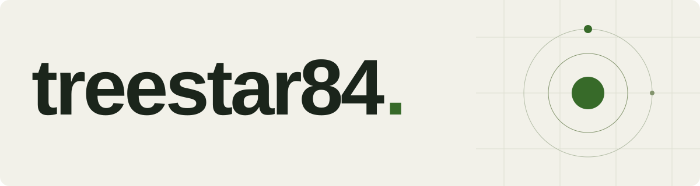

<picture>
  <source media="(prefers-color-scheme: dark)" srcset="./assets/hero-dark.svg">
  <source media="(prefers-color-scheme: light)" srcset="./assets/hero-light.svg">
  
</picture>

**ENTJ**

[Repositories →](https://github.com/treestar84?tab=repositories)

## Selected work

| AI developer tools | Game systems |
| :--- | :--- |
| **[memory-brain](https://github.com/treestar84/memory-brain)** AI 코딩 CLI를 위한 파일 기반 장기 기억. 대화와 결정의 근거를 다음 세션으로 이어갑니다. TypeScript · Bun · Markdown | **[loop-forge](https://github.com/treestar84/loop-forge)** 자가 대국과 회귀 검증을 결합한 게임 전략 실험 엔진. TypeScript · Self-play · Evaluation |
| **[rulebench](https://github.com/treestar84/rulebench)** 에이전트 규칙이 실제로 도움이 되는지 대조 실험으로 비교합니다. JavaScript · Benchmarks · Ablation tests | **[VibeMUD](https://github.com/treestar84/vibemud)** 코딩 도구 옆에서 함께 진행되는 로컬 방치형 RPG. Rust · SQLite · Claude Code |

## Stack

`TypeScript` · `JavaScript` · `Rust` · `Bun` · `SQLite`

## Activity

<a href="https://github.com/Platane/snk">
  <picture>
    <source media="(prefers-color-scheme: dark)" srcset="https://raw.githubusercontent.com/treestar84/treestar84/output/github-snake-dark.svg">
    <source media="(prefers-color-scheme: light)" srcset="https://raw.githubusercontent.com/treestar84/treestar84/output/github-snake.svg">
    
  </picture>
</a>

---

[@treestar84](https://github.com/treestar84)
